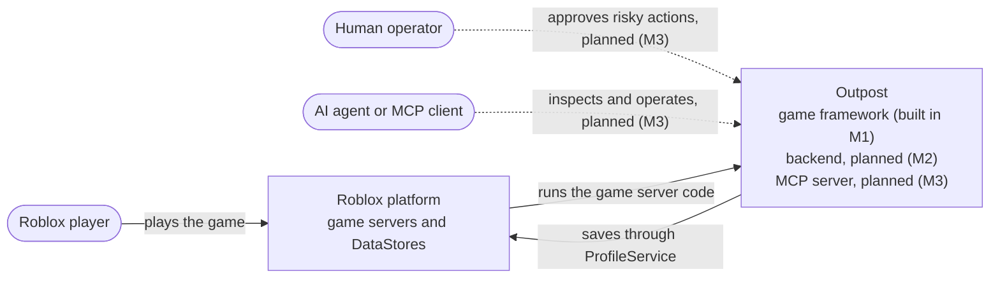
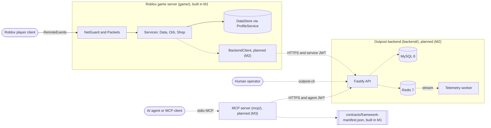
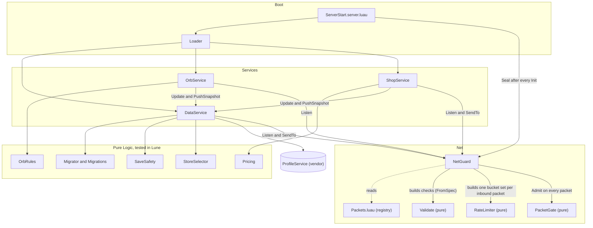
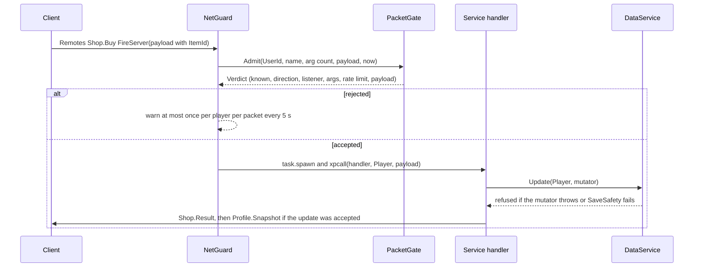

# Outpost architecture

Outpost is designed as three things in one repo: a server-authoritative Roblox game framework (`game/`), a game backend it talks to (`backend/`), and an agent-safe operations layer over MCP (`mcp/`). This document shows the target system and marks clearly what exists today.

**Status legend:** anything labelled **planned (M2)** or **planned (M3)** is designed but not built yet. Milestone 1, the game framework, is what this version of the repo contains. There is no `backend/`, `mcp/` or `evals/` folder yet.

| Part | Folder | Status |
|---|---|---|
| Game framework and the sample "Orbs" game | `game/` | built in M1 |
| Framework manifest and its JSON Schema | `contracts/` | built in M1 |
| Repo tooling and CI | `tools/`, `.github/workflows/ci.yml` | built in M1 |
| Game backend (Fastify, MySQL, Redis, telemetry worker) | `backend/` | planned (M2) |
| Game-side `BackendClient`, `EconomyService`, `TelemetryService`, `FlagService` | `game/` | planned (M2) |
| OpenAPI contract for the backend | `contracts/` | planned (M2) |
| MCP server and `outpost-cli` approvals | `mcp/` | planned (M3) |
| Eval harness and scorer | `evals/` | planned (M3) |

## System context

## Containers

Solid arrows exist today. Dotted arrows are planned. Roblox clients will never talk to the backend directly; only the game server will.

## Game server components (built in M1)

Shared modules (`Logic`, `Configs`, `Enums`, `Net/Packets`) never `require` anything, because Roblox requires take instances and Lune requires take strings. `NetGuard` does the wiring: it compiles each inbound packet's payload spec with `Validate.FromSpec`, makes a `RateLimiter` for it, and hands both to `PacketGate`, which only calls what it was given.

The client mirrors this with `ClientStart`, the same `Loader`, `NetClient`, and two controllers (`OrbController`, `HudController`). `NetClient` refuses to fire a server-to-client packet or listen to a client-to-server one, so a typo fails loudly. Nothing the client does is trusted by the server.

| Component | File |
|---|---|
| Server boot | `game/src/ServerScriptService/ServerStart.server.luau` |
| Client boot | `game/src/StarterPlayer/StarterPlayerScripts/ClientStart.client.luau` |
| Loader | `game/src/ReplicatedStorage/Shared/Util/Loader.luau` |
| Packet registry | `game/src/ReplicatedStorage/Shared/Net/Packets.luau` |
| NetGuard | `game/src/ServerStorage/Classes/Util/NetGuard.luau` |
| NetClient | `game/src/ReplicatedStorage/Classes/Util/NetClient.luau` |
| PacketGate, RateLimiter, Validate | `game/src/ReplicatedStorage/Shared/Logic/Net/` |
| Template, Migrator, Migrations, SaveSafety, StoreSelector | `game/src/ReplicatedStorage/Shared/Logic/Data/` |
| Pricing, OrbRules | `game/src/ReplicatedStorage/Shared/Logic/Economy/` |
| Services | `game/src/ServerStorage/Classes/Services/` |
| Controllers | `game/src/ReplicatedStorage/Classes/Controllers/` |
| ProfileService (third party, never edited) | `game/vendor/ProfileService.luau` |

## Key flows

### Boot

1. `ServerStart` calls `Loader.LoadFolders` on `ServerStorage.Classes.Services`. It skips modules with a truthy `Disabled` attribute, modules named `-Template-`, and class modules (anything with `new` or `Get`). A module that fails to `require` is warned about and skipped. The rest are ordered by `Priority` (DataService is 10, the rest default to 100), then by name.
2. `Loader.InitAll` runs each `Init` in its own coroutine and checks that the coroutine finished. Services call `NetGuard.Listen` here. An Init that errors or yields is warned about and left out, so it is never Started. A yielding Init's coroutine is closed with `coroutine.close`, so the rest of that Init can never run later. A handler that Init already registered with `NetGuard.Listen` stays registered, though; see the known gaps in [docs/threat-model.md](docs/threat-model.md).
3. `NetGuard.Seal()` seals the gate, creates `ReplicatedStorage.Remotes` with one `RemoteEvent` per packet, and connects `OnServerEvent` only for client-to-server packets. The packet name each connection passes to the gate is bound on the server, not read from the client. After Seal, `Listen` errors.
4. `Loader.StartAll` runs each `Start` in its own thread under `pcall`, so one slow or failing Start never holds up the rest.

### A packet from a client

`PacketGate.Admit` runs its checks in a fixed order: unknown packet, wrong direction, no listener, too many arguments, rate limit, payload. The token is spent before the payload is checked, so spam with broken payloads still drains the bucket. Admit never throws on client input: a name that is not a string is `UnknownPacket` (all unknown names share one log slot per player, so made-up names cannot grow memory), an argument count that is not a number of at most 1 is `TooManyArguments`, and the payload check runs under `pcall` and must return exactly `true`. A bad player key or clock reading fails closed as `Throttled`. When a player leaves, `NetGuard` calls `Forget`, which drops their buckets and log timers.

### A purchase

`ShopService` calls `DataService:Update` once. Inside the mutator it runs `Pricing.Decide(Shop, ItemId, Data.Coins, Data.OwnedItems)` on the draft and, on `Granted`, writes the new balance and the owned flag. The price comes only from `Configs/Shop`; `Decide` has no price parameter. `Decide` fails closed: Coins that are not a number, NaN, negative or infinite give `TooPoor`, and an `Owned` that is not a table is treated as empty. Because the decision and the charge happen in one `Update` with no yield between them, two racing buys cannot both pay out. If the update is refused, the client gets `Unavailable`.

### An orb pickup

`OrbService` looks the orb up by id, measures the distance from the player's `HumanoidRootPart` itself (no character means an infinite distance), and asks `OrbRules.CanCollect`. That fails closed: a non-finite or negative distance gives `NoPosition`, and a non-finite `Now` or last pickup time gives `Cooldown`. On success the orb is removed from the table and destroyed before the Coins are paid through `DataService:Update`, with no yield between the check and the removal, so a second request for the same orb finds nothing. A new orb spawns 3 seconds later.

### A save

- **Store choice.** `StoreSelector.Choose` picks Live only for the listed live place on a real server. Studio, unknown places and place 0 never get Live. In M1 `Configs/Places` lists no live place, so Live is never used.
- **Load.** `LoadProfileAsync("Player_<UserId>", "ForceLoad")` takes ProfileService's session lock. `Migrator.Run` upgrades a copy; a save from a newer version, a bad `SchemaVersion` or a throwing migration releases the profile untouched and kicks the player. The migrated copy is moved in with `SaveSafety.ReplaceContents`, then `Reconcile` fills missing fields, then `SaveSafety.Check` runs on the result. If that fails, the original data is put back, the profile is released and the player is kicked, so the save is left exactly as it was loaded. Only checked data becomes `LastGood`.
- **Change.** Services change saves through `DataService:Update`, which runs `SaveSafety.TryUpdate`: the mutator runs under `pcall` on a deep copy, the copy is checked, and only a safe copy is moved into the live table. `LastGood` is refreshed after each accepted update. `GetData` does hand back the live table. The release check below protects the final save, but ProfileService's 30 s autosave would still write anything changed around `Update` before release (see the known gaps in [docs/threat-model.md](docs/threat-model.md)).
- **Release.** `PlayerRemoving` and a `BindToClose` handler both run the same step: one more `SaveSafety.Check`, and if the data is unsafe it is replaced by a copy of `LastGood` before `Release`.
- **What Check refuses.** NaN, infinities, functions and other unsaveable types, mixed or gapped tables, keys that are not strings or list indexes, metatables, cycles, invalid UTF-8 in values or keys, and nesting deeper than 64 levels.

### Planned flows

Purchase through the backend ledger, earn batching, telemetry ingest, and the agent refund with a human approval are **planned (M2)** and **planned (M3)**. Their sequence diagrams arrive with the code, following the design in [docs/superpowers/specs/2026-10-06-outpost-design.md](docs/superpowers/specs/2026-10-06-outpost-design.md) section 6.

## Tooling and checks

`bash tools/ci/luau-check.sh` runs every Luau check CI runs, in order: `--!strict` headers on every `.luau` file under `game/src`, `game/tests` and `game/scripts`; StyLua format check; selene lint (warnings fail); strict `luau-lsp analyze`; the Lune unit tests; `rojo build`; and the manifest drift and schema checks.

Strict `luau-lsp` analysis covers `game/src` only, the code that ships. Tests and scripts are format-checked and linted (StyLua, selene) and must carry the `--!strict` header, but they are not strict-analyzed. `game/vendor/` is excluded from formatting, linting and type checking.

`tools/check-module-size.mjs` fails CI if any Luau, TypeScript or JavaScript module goes over 700 lines. CI (`.github/workflows/ci.yml`) has three jobs. `changes` is a path filter. `repo-hygiene` always runs (the module size check and its tests, a secret scan, offline Markdown link check). `luau` needs `changes` and runs the script above only when `game/`, `contracts/`, `tools/ci/` or the workflow changes.

## Decisions

| ADR | Decision |
|---|---|
| [0001](docs/adr/0001-monorepo-and-pinned-luau-toolchain.md) | Single monorepo, Rokit-pinned Luau toolchain |
| [0002](docs/adr/0002-pure-logic-tested-in-lune.md) | Pure Logic modules tested in Lune |
| [0003](docs/adr/0003-service-lifecycle.md) | Loader, non-yielding Init, spawned Start, sealed NetGuard |
| [0004](docs/adr/0004-profileservice-and-schema-migrations.md) | ProfileService behind DataService, schema migrations |
| [0005](docs/adr/0005-server-authoritative-remotes.md) | One packet registry, per-player token buckets, plain RemoteEvents |
| [0006](docs/adr/0006-naming-and-module-size.md) | Naming per language and the 700-line limit |

ADRs 0007 to 0015 (backend storage, ledger, telemetry, trust, MCP tiers, evals, failure posture, observability) are planned (M2) and planned (M3).

## Contracts

`contracts/framework-manifest.json` is generated by `game/scripts/ExportManifest.luau` and validated against `contracts/framework-manifest.schema.json` in CI. It lists every service and controller (with its Init, Start and the packets it listens to) and every packet (with direction, payload summary and rate limit). CI regenerates it and fails if the committed copy is stale. The OpenAPI contract for the backend is planned (M2).

## Threat model

Client exploit threats, the defences against them, and the known gaps are in [docs/threat-model.md](docs/threat-model.md). Backend, credential and agent threats are planned (M2) and planned (M3).
