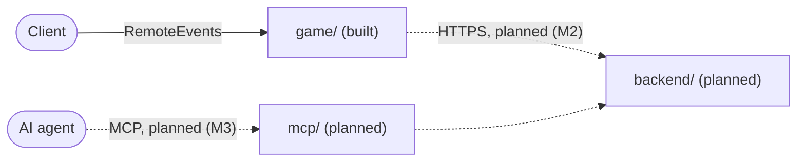

# Outpost

A server-authoritative Luau client framework, the TypeScript backend it talks to, and an agent-safe operations layer (MCP) on top, all in one repo. The sample app, "Orbs" (collect orbs, earn Coins, buy a cosmetic), exists only to exercise the framework. Nothing here runs in production and there is no user count.

Only the framework (`game/`, milestone M1) is built. The backend is planned (M2) and the MCP layer is planned (M3). The diagram shows dotted arrows for the parts that do not exist yet.



The full picture is in [ARCHITECTURE.md](ARCHITECTURE.md).

## Media

These are placeholders until the recordings exist (M4):

- `docs/media/orbs-demo.gif` will show the Orbs loop: collecting orbs, Coins rising, buying the Red Hat.
- `docs/media/jaeger-trace.png` will show one MCP call traced through the backend into MySQL (M3).
- `docs/media/eval-report.png` will show the first live eval report (M3).

## Quickstart (Luau, about 2 minutes)

Install [Rokit](https://github.com/rojo-rbx/rokit), then:

```bash
cd game
rokit install
lune run tests/Runner
rojo serve
```

`lune run tests/Runner` runs every Lune spec and ends with a line like `140 passed, 0 failed, 14 spec files`. Connect the Rojo plugin in Studio and press Play to try the sample. M1 needs no Docker and no backend.

From the repo root, `bash tools/ci/luau-check.sh` runs every check in the `luau` CI job. The `repo-hygiene` job's module size checks run locally with `npm run check:size` and `node --test tools/check-module-size.test.mjs` (also `npm run test:tools`). Its secret scan (gitleaks) and link check (lychee) run in CI only.

The full-system quickstart (`pnpm setup:dev`, then `docker compose up -d --build --wait && pnpm demo`) arrives with M2. The demo trades the game key for a token on every run, and the backend allows about 30 of those a minute, so a tight loop of more runs gets a 429 on the first step.

## What to look at first

- **Luau reviewers:** [NetGuard](game/src/ServerStorage/Classes/Util/NetGuard.luau), [Packets.luau](game/src/ReplicatedStorage/Shared/Net/Packets.luau), [PacketGate](game/src/ReplicatedStorage/Shared/Logic/Net/PacketGate.luau), [DataService](game/src/ServerStorage/Classes/Services/DataService.luau) with [Migrator](game/src/ReplicatedStorage/Shared/Logic/Data/Migrator.luau), and [ADR 0005](docs/adr/0005-server-authoritative-remotes.md).
- **Backend reviewers:** planned (M2). The ledger, refresh-token reuse detection and ADR 0008 land there.
- **AI and agent reviewers:** planned (M3). The policy tier map, approvals, the untrusted-text wrapper and the eval report land there. Today, [the framework manifest](contracts/framework-manifest.json) is what the MCP server will read.
- **Architects:** [ARCHITECTURE.md](ARCHITECTURE.md), [the threat model](docs/threat-model.md), and [the ADRs](docs/adr/).

## Status

| Milestone | Scope | Status |
|---|---|---|
| M1, the framework | Loader, NetGuard, DataService, Orbs, Lune tests, CI, ADRs 0001 to 0006 | Built |
| M2, the backend | Identity, economy ledger, telemetry, flags, Compose, contract tests | Planned |
| M3, the agent layer | MCP server, approvals, evals with record and replay | Planned |
| M4, production polish | Load test numbers, dashboards, infra validation, recorded media | Optional |

## Repo map

| Folder | What it is |
|---|---|
| `game/` | Rojo project, strict Luau, Lune tests ([game/README.md](game/README.md)) |
| `contracts/` | The generated framework manifest and its JSON schema |
| `tools/` | The 700-line module check and the local CI script |
| `docs/` | ADRs, the threat model, the design spec and plans |

## About

Built with AI pair programming (Claude Code). I set the design and scope, and every change passed review and tests before merging.

To report a security problem, see [SECURITY.md](SECURITY.md).

Licensed under [MIT](LICENSE). `game/vendor/ProfileService.luau` is third-party code under the Apache License 2.0, see [game/README.md](game/README.md).
